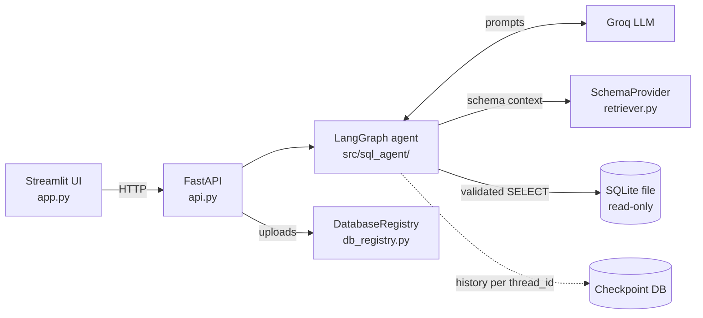
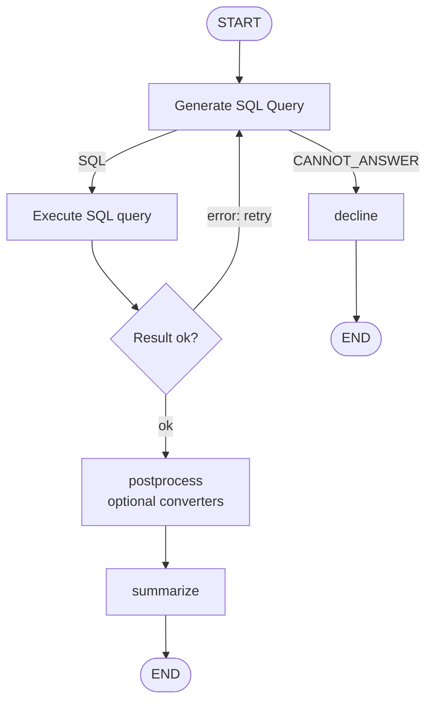

# Text to SQL Query AI Assistant Converter

This repository consists of a simple application powered by Streamlit that
utilises an open source Large Language Model that generates SQL querys from
natural laugange input. It allows you to efficiently create SQl queries to
provide downstream data analysis for business users and stakeholders, through a read-only agent that answers plain-English questions about any SQLite `.db` file by writing, validating and running SQL for you.

## Overview

Upload a SQLite database, ask a question, and get the generated SQL, a results table (with CSV download) and a short written answer. The agent is a [LangGraph](https://langchain-ai.github.io/langgraph/) state machine served by FastAPI, with a Streamlit client. The LLM is Groq-hosted `qwen/qwen3.8-27b`, configurable in `utils/config.yaml`. The agent never modifies your database.

## Architecture

System overview:



Agent graph:



- `generate_sql` builds a prompt from the question and the schema of the request's database, then asks the LLM for one query. If the request cannot be answered read-only (a write, or off-topic), the model answers `CANNOT_ANSWER` and the graph ends at `decline` without running anything.
- `execute_sql` checks the query with the guardrail, runs it, and sets an error on a guardrail failure, a SQLite error or an empty result. The router then retries with that error text added to the prompt, up to `agent_loop.max_attempts` (default 3).
- `postprocess` applies the optional numeric converters before `summarize`, so the written answer and the table agree.
- `summarize` writes the answer from at most 20 result rows. Conversation history is kept per `thread_id` in a SQLite checkpoint file.

Read-only safety is layered, and the prompt is never the security boundary:

1. **Guardrail** (`guardrails.py`, sqlglot): exactly one `SELECT` or `UNION`, no write or DDL statements, and `LIMIT` injected or capped at `guardrails.max_rows`.
2. **Read-only connection** (`executor.py`): SQLite opened with `mode=ro` and a query timeout.
3. **Upload validation** (`db_registry.py`): allowed suffix, SQLite magic header and size are checked, and the file is stored under a random name.

Schema context depends on database size. Databases with 8 tables or fewer send the full schema. Larger ones use a hybrid FAISS (semantic) and BM25 (keyword) retriever, then add foreign-key neighbours of the matches. Each database has its own cache and index, keyed by `db_id`.

Repository layout:

```
.
├── api.py                      # FastAPI app factory and endpoints
├── app.py                      # Streamlit client
├── src/sql_agent/
│   ├── graph.py                # LangGraph wiring and routing
│   ├── nodes.py                # generate / execute / postprocess / summarize / decline / give_up
│   ├── prompts/                # LLM prompt templates as .md files (generate_sql, retry_feedback, summarize, conversion_note)
│   ├── state.py                # AgentState shared by all nodes
│   ├── guardrails.py           # sqlglot SELECT-only validation, LIMIT cap
│   ├── executor.py             # read-only SQLite connection, query timeout
│   ├── retriever.py            # per-database schema context (full or hybrid retrieval)
│   └── postprocess/            # optional converters: currency, units (pint), durations, numbers, datetime; per-database detection
├── utils/
│   ├── config.yaml             # all settings
│   ├── llm.py                  # builds the chat model (Groq by default)
│   ├── schema.py               # introspects tables, foreign keys, sample rows
│   ├── db_registry.py          # upload validation, db_id to path, TTL cleanup
│   └── helpers.py              # SQL output cleaning, currency parsing helpers
├── db/                         # sample databases
└── tests/                      # pytest suite (fake LLM, fixture databases)
```

## Installation & Setup

Requires Python 3.10 or newer and [uv](https://docs.astral.sh/uv/).

```bash
git clone <repository_url>
cd text-to-sql
curl -LsSf https://astral.sh/uv/install.sh | sh   # skip if uv is installed
uv sync
```

Check that `llm.model_name` in `utils/config.yaml` is a model currently
available on your Groq account. Ensure GROQ API key is configured.

| Variable | Required (Yes/No) | Description |
|---|---|---|
| `GROQ_API_KEY` | Yes | Groq credential, read from the environment or `.env`. Never commit `.env`. |
| `API_BASE_URL` | No | Backend URL the Streamlit client calls. Default `http://127.0.0.1:8000`. |
| `CHAT_TIMEOUT_S` | No | Seconds the client waits for a `/chat` response. Default `90`. |

To change what the LLM is told, edit the Markdown templates in `src/sql_agent/prompts/`. Placeholders use `{name}` syntax, and a literal brace must be written `{{` or `}}`.

| Template | Used by | Placeholders |
|---|---|---|
| `generate_sql.md` | `generate_sql`: writes the query, and holds the `CANNOT_ANSWER` rule | `question`, `db_schema`, `feedback` |
| `retry_feedback.md` | `generate_sql` on a retry: the failed SQL and its error | `sql`, `error` |
| `summarize.md` | `summarize`: writes the plain-English answer | `note`, `question`, `row_count`, `shown`, `sample` |
| `conversion_note.md` | `summarize`: names columns the converters changed | `parts` |

Keep `CANNOT_ANSWER` in `generate_sql.md`, because the decline path depends on that exact word. Run `uv run pytest` after editing a template, since the tests check the retry text.

Edit `utils/config.yaml` for everything else:

| Key | Description |
|---|---|
| `default_db` | Sample database served when a request has no `db_id` (`db/noshow.db`). |
| `llm` | `model_name`, `model_provider` (`groq`), `temperature`. |
| `retrieval` | `sample_limit` (sample rows per table sent to the LLM, `0` disables), `full_schema_max_tables`, `k`, hybrid weights, embedding model. The hybrid settings apply only to databases above the table cutoff and are experimental; see Known limitations. |
| `guardrails` | `max_rows`, `query_timeout_s`. |
| `agent_loop` | `max_attempts`: SQL generation attempts per question. `history_turns`: earlier turns shown to the model for follow-up questions (default 5, `0` turns it off). |
| `uploads` | `dir`, `max_mb`, `ttl_hours` (uploads unused for this long are deleted), `cleanup_interval_min` (how often the server checks for expired uploads). |
| `checkpoint_db` | SQLite file for conversation history. |
| `postprocess` | `default_enabled` converters and per-converter settings: currency rates, unit targets, duration target, date order. |

Uploaded files survive a server restart: at startup the server re-registers files in `uploads.dir`, so existing `db_id` values keep working, and deletes any older than `ttl_hours`. The same cleanup runs every `cleanup_interval_min` minutes and after each upload. An upload counts as expired `ttl_hours` after it was last used (any schema or chat request) or saved, whichever is later. Last use is tracked in memory only, so after a restart the age falls back to when the file was saved.

The embedding model downloads on first use, and only when a database has more than `full_schema_max_tables` tables.

## Usage

```bash
uv run uvicorn api:app --reload      # backend on :8000
uv run streamlit run app.py          # UI, in a second terminal
```

Run both commands from the repository root, because the paths in `utils/config.yaml` are relative to it.

1. Open the Streamlit page, upload a `.db`, `.sqlite` or `.sqlite3` file in the sidebar and click **Load database**. Skip this step to use the sample database.
2. Ask a question in the chat box. The page shows the answer, the results table, a CSV download, and an expander with the generated SQL and every attempt.
3. Click **New conversation** to clear the history for the current database.

Call the API directly with curl:

```bash
curl -X POST http://127.0.0.1:8000/chat \
  -H "Content-Type: application/json" \
  -d '{"message": "How many rows are in each table?"}'
```

**Follow-up questions.** Within one conversation you can refer back to earlier questions: "Now only Orchard", "And how many bookings does it have?". The model is shown your last few questions with the SQL that answered them (never the result rows). A new conversation, or loading another database, starts with no history. Set `agent_loop.history_turns` in `utils/config.yaml` to change how many turns are shown, or `0` to turn it off.

**Conversions.** Some databases store values as text: `USD$ 12.30`, `5 kg`, `2h 30m`, `1.2K`, `05/10/1973`. Converters turn them into plain numbers (or ISO 8601 dates) so sums, averages, sorting and comparisons are correct. Conversions are off by default. Choose them in the sidebar, or send `"conversions": ["auto"]` to `/chat`.

| Converter | Reads | Converts to |
|---|---|---|
| `currency` | `USD$ 12.30` | number in the base currency (static rates in `config.yaml`) |
| `units` | `5 kg`, `30 cm`, `98 °F` (length, mass, volume, temperature; uses [pint](https://pint.readthedocs.io/)) | one target unit per dimension |
| `durations` | `2h 30m`, `90 min`, `1:30:00` | one target unit (minutes by default) |
| `numbers` | `1,234.50`, `1.2K`, `3M`, `(123)` | plain numbers |
| `datetime` | `05/10/1973`, `01/01/2023 0:00`, `12 Mar 2024` | ISO 8601 text (`1973-10-05`) |

- **Auto-detect** (`"auto"`) scans up to 200 sampled values of every text column once per database and turns on only the converters that recognise a column. The sidebar lists the detected columns. Databases without such columns are unaffected.
- **They also work inside the SQL.** Each enabled converter is available to the model as a SQLite function (`convert_currency`, `convert_units`, `convert_durations`, `convert_numbers`, `convert_datetime`), and the prompt tells the model which columns to use it on. If the model aggregates, sorts or compares a detected column raw, the query is sent back for a retry, because comparing text such as `31/08/2023 9:58` gives wrong answers that look right.
- **Settings.** Pick target units, the currency, the duration unit and the date order (day first or month first) in the sidebar, or send `"conversion_options": {"units": {"length": "mi"}}`. See `GET /conversions` for the choices.
- Conversions change only returned values and never your database. Ambiguous values are left alone: a column that mixes day-first and month-first dates is not converted, and a lone `5 m` is metres, not minutes.

**Privacy.** Groq is a cloud API. The schema, sample rows (`retrieval.sample_limit`) and up to 20 result rows are sent to it. Do not upload data you cannot share with a third party.

### Test

```bash
uv run pytest                        # all tests
uv run pytest -m "not slow"          # skip tests that load the real embedding model
```

Tests use a fake LLM and fixture databases, so they need no API key. Tests marked `slow` load the real embedding model and need network access on the first run.

## API Reference

The backend also serves interactive OpenAPI docs at `http://127.0.0.1:8000/docs`.

### GET /health

Reports that the backend is running.

- **Request Body / Inputs**: none
- **Response / Expected Output**: `{"status": "ok"}`

### GET /conversions

Lists the configured converters and their settings, for the UI.

- **Request Body / Inputs**: none
- **Response / Expected Output**: `{"available": [{"name", "label", "options": [{"key", "label", "choices", "default"}]}], "default": [names]}`. The first entry, `auto`, has no options.

### POST /upload-db

Validates and stores an uploaded SQLite file, and returns its identifier. Invalid files return 400.

- **Request Body / Inputs**: multipart form with `file` (`.db`, `.sqlite` or `.sqlite3`, within `uploads.max_mb`)
- **Response / Expected Output**: `{"db_id": "<12-char id>"}`

### GET /schema

Lists the tables of a database. An unknown `db_id` returns 404.

- **Request Body / Inputs**: query parameter `db_id` (optional, defaults to the sample database)
- **Response / Expected Output**: `{"tables": [{"name", "columns": [..], "rows": int}], "convertible": [{"table", "column", "converter"}]}`

### POST /chat

Runs the agent for one question. An unknown `db_id` returns 404, an unknown conversion name returns 400, and a workflow error returns 500.

- **Request Body / Inputs**: `{"message": str, "thread_id": str?, "db_id": str?, "conversions": [str]?, "conversion_options": {name: {key: value}}?}`. Names are `auto` or converter names; omit `conversions` to use `postprocess.default_enabled`. An invalid name, option or value returns 400.
- **Response / Expected Output**: `{"thread_id", "answer", "sql", "columns", "rows", "truncated", "failed", "declined", "conversions_applied": [{"column", "converter", "detail"}], "attempts", "trace"}`

## Known limitations

- **Large schemas:** on databases with many tables, the retriever may pick extra tables or miss a needed one, which can lead to a declined question or a wrong query. Quality has only been tested on small synthetic databases.
- **Wide tables:** every column of a selected table is sent to the model, so very wide tables increase prompt size. Lower `retrieval.sample_limit` to reduce it.
- **Multi-table questions:** each question runs against a single database file, and joins on non-unique keys can inflate counts.
